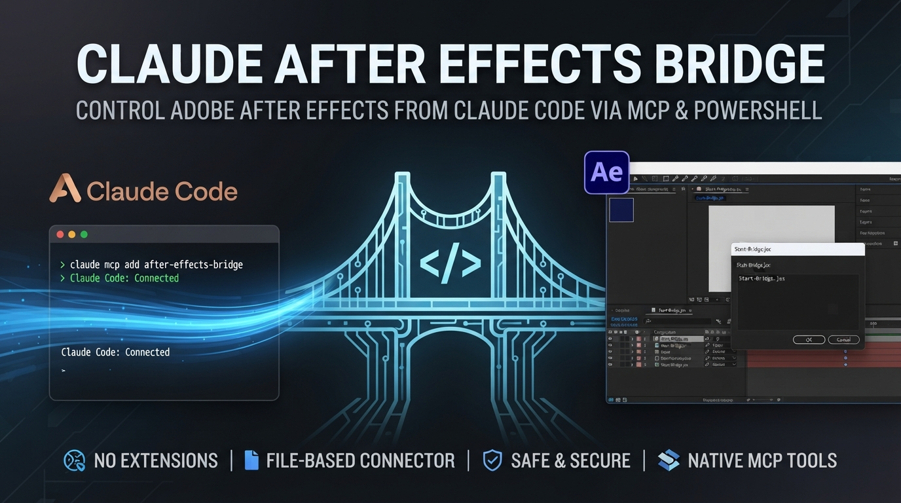

# Claude After Effects Bridge



Control **Adobe After Effects** from **Claude Code**. Claude can inspect your project and compositions, then build and edit layers, keyframes, text, effects and render queue items. It works by running ExtendScript inside After Effects through a small local connector.

```
Claude Code ──MCP stdio──▶ mcp/server.cjs ──▶ Invoke-AfterEffects.ps1 ──▶ local/inbox/<id>.jsx
                                                                                  │ polled every 500 ms
Claude Code ◀── JSON ◀── local/requests/<id>.json ◀── Start-Bridge.jsx (inside After Effects)
```

- **No extension to install.** You run `Start-Bridge.jsx` once per After Effects session from **File → Scripts → Run Script File**.
- **No network ports and no npm packages.** After Effects and the client talk only through files in this folder.
- **Safe by design.** Requests are snapshotted, only one client runs at a time, timeouts never replay work, and every result is saved for later lookup.
- **Two ways to use it.** Claude Code gets native MCP tools, and the same PowerShell clients also work directly from any shell.

## Requirements

| Technology | Requirement |
| --- | --- |
| Operating system | Windows 10 / 11 |
| Adobe After Effects | ExtendScript scripting support (CC 2019 / 16.0 or newer; originally used with 26.0x67) |
| PowerShell | Windows PowerShell 5.1 (built in) or PowerShell 7+ |
| Node.js | 18 or newer: https://nodejs.org (runs the MCP server) |
| Claude Code | CLI (`npm install -g @anthropic-ai/claude-code`) or the desktop app |

There are no Python packages and no `npm install` step. See [requirements.txt](requirements.txt).

## Install

### 1. Clone into a permanent folder

```bash
git clone https://github.com/MrUzbek00/Claude-Code-After-Effect-Connector.git
```

Use a private, writable folder owned by your user. The bridge exchanges files there.

### 2. Run setup

From PowerShell in the repository:

```powershell
powershell.exe -NoProfile -ExecutionPolicy Bypass -File .\Setup.ps1
```

Setup creates the `local/` runtime folders and registers the MCP server with Claude Code:

```
claude mcp add after-effects-bridge --scope user -- node "<repo>\mcp\server.cjs"
```

Use `-SkipMcp` to skip the registration. `-ExecutionPolicy Bypass` applies only to that one PowerShell process. Setup installs no software and changes no Adobe settings.

### 3. Allow scripting in After Effects (once)

Turn on **Edit → Preferences → Scripting & Expressions → Allow Scripts to Write Files and Access Network**.

### 4. Start the bridge (each After Effects session)

In After Effects, choose **File → Scripts → Run Script File** and select this repository's **`Start-Bridge.jsx`**. Run it from the repository so it finds its `local/` folder; don't copy it elsewhere. Repeat after every restart of After Effects.

### 5. Verify

Restart Claude Code (or run `/mcp`) and ask:

> Check the After Effects bridge and list my compositions. Don't change anything.

Or check from PowerShell:

```powershell
powershell.exe -NoProfile -ExecutionPolicy Bypass -File .\Test-Connection.ps1
powershell.exe -NoProfile -ExecutionPolicy Bypass -File .\Invoke-AfterEffects.ps1
```

A working bridge returns `online: true`, then `ok: true` with the After Effects version and your compositions.

## MCP tools Claude gets

| Tool | Changes the project? | What it does |
| --- | --- | --- |
| `ae_status` | No | Bridge heartbeat and any unresolved requests |
| `ae_project_info` | No | Version, project path, active item, all compositions |
| `ae_run_script` | **Can** | Runs ExtendScript (`code` or `scriptPath`) and returns the last expression as JSON |
| `ae_get_result` | No | Looks up a saved result by request ID (after a timeout) |

[CLAUDE.md](CLAUDE.md) gives Claude the rules for writing After Effects ExtendScript and handling timeouts safely. Copy it into your own projects, or reference it there, if you use Claude Code from another folder.

### Example prompts

- "List every layer in the active comp with its in and out points."
- "Add a centered title that says *Episode 4* and fade it in over half a second."
- "Add all compositions whose names start with `FINAL_` to the render queue."
- "Find text layers whose text contains a typo and show them to me before fixing anything."

## PowerShell commands

| File | Purpose |
| --- | --- |
| `Setup.ps1` | Create local folders and register the MCP server (`-SkipMcp` to skip) |
| `Start-Bridge.jsx` | Start polling inside After Effects |
| `Stop-Bridge.jsx` | Stop polling (run from After Effects' Run Script File menu) |
| `Test-Connection.ps1` | Report heartbeat and pending requests |
| `Invoke-AfterEffects.ps1 [-ScriptPath x.jsx] [-TimeoutSeconds 120]` | Queue one script and wait for its JSON result |
| `Get-BridgeResult.ps1 -RequestId <id>` | Read a saved result without running anything again |
| `project-info.jsx` | Default read-only project inspection |
| `scripts/Package.ps1` | Build a source ZIP from an explicit file allowlist |

Claude Code can also call these directly through its shell tool if you don't want MCP. See [docs/CLAUDE-CODE.md](docs/CLAUDE-CODE.md).

## Timeouts and recovery

The default wait is 120 seconds (`timeoutSeconds` 1–3600). **A timeout does not cancel queued or running work.** The error includes the request ID. Inspect the project, then look up the result with `ae_get_result`, or with:

```powershell
powershell.exe -NoProfile -ExecutionPolicy Bypass -File .\Get-BridgeResult.ps1 -RequestId <32-character-id>
```

Never retry an edit automatically. While a request is still queued or running, new submissions are refused, and so is starting a new bridge. See [docs/TROUBLESHOOTING.md](docs/TROUBLESHOOTING.md).

## Updating and removing

Update with `git pull`. Then run `Stop-Bridge.jsx` and `Start-Bridge.jsx` in After Effects, and restart Claude Code.

To remove it, run `Stop-Bridge.jsx` (or close After Effects), run `claude mcp remove after-effects-bridge --scope user`, and delete the folder. Nothing else is installed.

## Development

```powershell
npm run check   # JSX, MCP server and PowerShell syntax
npm test        # real PowerShell clients + MCP server against a mocked After Effects
```

Use `npm.cmd` if PowerShell blocks `npm.ps1`. CI runs on Windows with Windows PowerShell 5.1 and PowerShell 7, on Node 20 and 22. It does not run After Effects itself.

## Documentation

- [Using it from Claude Code](docs/CLAUDE-CODE.md)
- [Architecture and file protocol](docs/ARCHITECTURE.md)
- [Troubleshooting and recovery](docs/TROUBLESHOOTING.md)
- [Security](SECURITY.md)
- [After Effects scripting guide](https://ae-scripting.docsforadobe.dev/)

## License

[MIT](LICENSE). Adobe After Effects and Claude Code are installed and licensed separately. This is an independent integration, not affiliated with Adobe.
